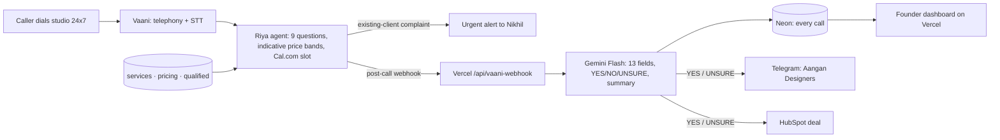

# Aangan Phone Desk: an AI phone agent for Aangan Studio, Pune

**MESA AI & its Application · Founder's Office · Case 03 ("Nikhil: Unanswered Enquiries")** by Roshni Rawtani

Live dashboard: **https://aangan-phone-desk.vercel.app**

Aangan Studio loses enquiries. About 48% get no reply within 48 hours, a third arrive outside 10am–7pm, and an enquiry answered within an hour converts at 4× the rate of a next-day reply. This project answers **every phone call within seconds, 24×7**, with a voice agent called **Riya**. It qualifies each caller against Nikhil's 5-point rubric and sends qualified leads to designers with every detail already captured. A live dashboard shows what the system generates and what it costs.



## How it works

```
Caller ──► Vaani (telephony + STT + Riya, Gemini Flash brain, knowledge base)
             │  asks 9 questions · shares indicative ₹/sq ft bands only · escalates existing clients
             ▼  post-call webhook
        Vercel /api/vaani-webhook
             │  Gemini Flash → 13 fields + 5 criteria → YES / NO / UNSURE / ESCALATE + 2-line summary
             ├─► Neon Postgres  (every call logged)
             ├─► Telegram group "Aangan Designers"  (YES / UNSURE / ESCALATE handoff note)
             └─► HubSpot deal  (YES / UNSURE)
        Vercel  /  → founder dashboard (calls, qualified %, bookings, ₹ cost/call, ₹ pipeline)
```

## Stack

| Layer | Tool |
|---|---|
| Voice, telephony and call orchestration | Vaani Labs (agent `riya-aangan-phone`) |
| Call classification | Gemini Flash |
| Call log and state | Neon (Postgres) |
| Designer handoff | Telegram bot `@aangan_handoff_rr_bot` |
| CRM | HubSpot (deals) |
| Hosting and dashboard | Vercel serverless functions + static page |
| Build | Claude Code, with GitHub for version control |

## Repository

| Path | What it does |
|---|---|
| `index.html` | Founder dashboard: live stats, outcomes, cost breakdown, recent calls, **Trigger a call** form |
| `api/vaani-webhook.js` | Receives Vaani's post-call payload, then scores, logs and hands off |
| `api/stats.js` | JSON stats for the dashboard (`?source=phone\|backtest\|all`) |
| `api/trigger-call.js` | Outbound call through the Vaani API (passcode protected) |
| `api/backtest.js` | Replays the 19 September phone transcripts through the pipeline |
| `api/demo.js` | Seeds or clears clearly-marked demo calls (`?action=seed\|clear`) |
| `api/setup.js` | Creates the Neon table and reports which integrations are configured |
| `lib/core.js` | Shared logic: rubric prompt, Gemini call, payload normalisation, Telegram, HubSpot, Neon |
| `data/transcripts.json` | Anonymised September 2026 phone transcripts (test set) |
| `docs/` | Submission write-up (Automation Brief, Nine Checks, the Cut, components map), Riya's prompt |
| `env.example` | Environment variable names (no values) |

## Results: backtest on 19 real September calls

- **15 / 19** got exactly the right verdict. **19 / 19** were correctly forwarded or held back, so no good lead was lost.
- All 6 declines were right (Nashik, advice-only, Diwali rush, ₹1–1.5 L budget, 180 sq ft pod, restaurant), and the existing-client complaint was escalated.
- Cost: **≈ ₹27 per call**, or **≈ ₹43 per qualified lead** (Vaani ₹5.60/min plus Gemini ≈ ₹0.25 per call).

## The Cut (Nine Checks, Check 06)

Nikhil asked for the agent to *quote* per-square-foot pricing. pricing.md says the guide is indicative only and varies by site. Riya shares **indicative bands with a caveat**, and the designer gives the actual price at the consultation. **Firm, project-specific quotes are cut.**

## Run your own

1. Create a Neon project and a Vercel project, then add the variables from `env.example`.
2. Deploy this folder to Vercel and open `/api/setup` once to create the table.
3. In Vaani, create an agent with `docs/Riya_Vaani_System_Prompt.txt` and add an Agent Webhook (event: *Call Post-Processing*) pointing at `https://<your-app>.vercel.app/api/vaani-webhook`.
4. Optional: open `/api/backtest?from=0&n=7` (then `from=7`, `from=14`) to replay the September calls.

Extending to WhatsApp or the web form only needs a new trigger posting a transcript to `/api/vaani-webhook`. Everything after that stays the same.
